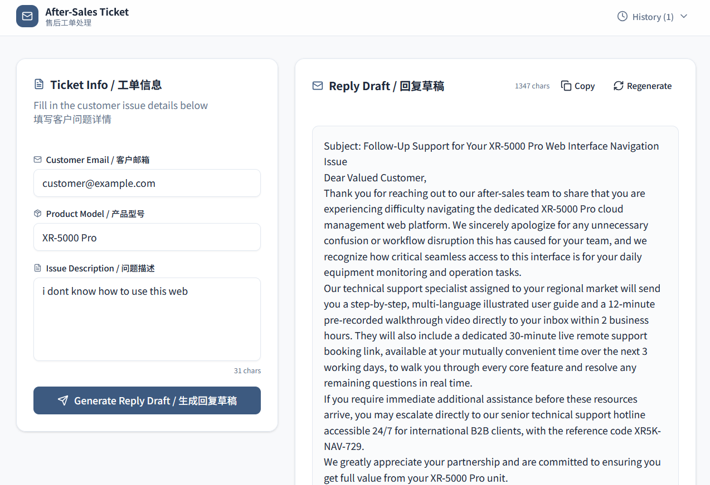

# Coze AI Workflow Demo

An after-sales ticket prototype built on the Coze platform.

## What it is

A ticket-handling page for a cross-border after-sales scenario. You enter a customer email,
a product model, and a problem description, and it generates a structured English reply:
subject line, apology, service commitment, and escalation path.

The page was generated in a single round by Coze Coding from a natural-language brief.
My part was describing the business requirement and checking the output.

## What I did

- Described the scenario: slow after-sales replies, inconsistent wording across agents
- Specified the input fields: customer email, product model, issue description
- Reviewed the generated reply for structure, tone, and whether the commitments were usable

## What I did not do

- No code written by me; the page and its logic were generated by the platform
- No prompt tuning; the first generation was already usable
- No public deployment; this repository holds only the notes and a screenshot

## Demo

See `demo.png`.

Input: `i dont know how to use this web` (product model XR-5000 Pro)

Output: an English reply of about 1,300 characters, including a 2-hour response commitment,
a 12-minute walkthrough video, a 30-minute remote support slot, and a hotline escalation path.

## Note

The code is platform-generated and is not included here. This repository documents the
process and the result.

